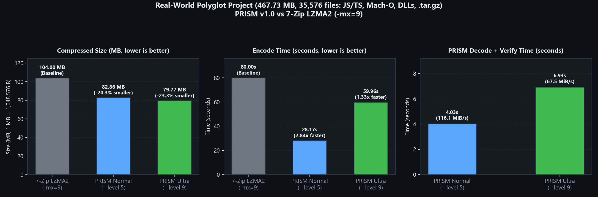
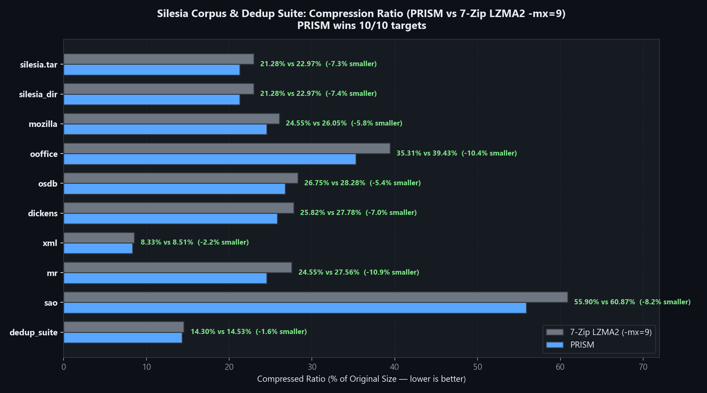
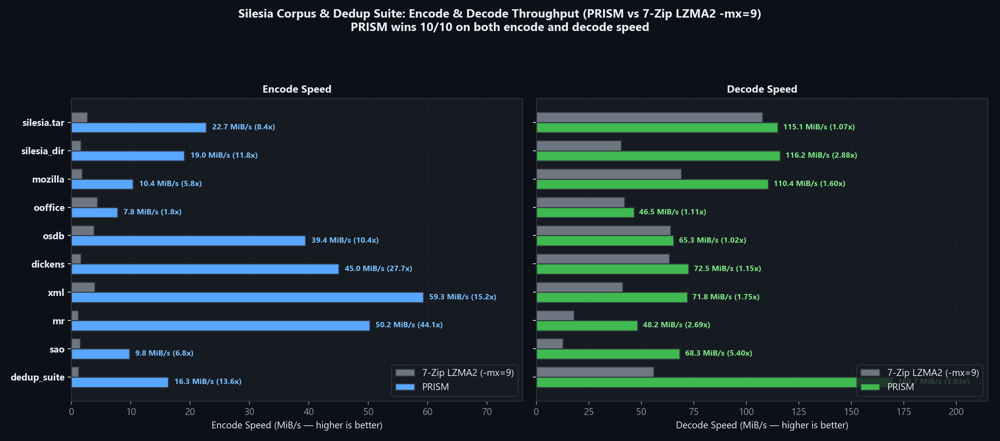
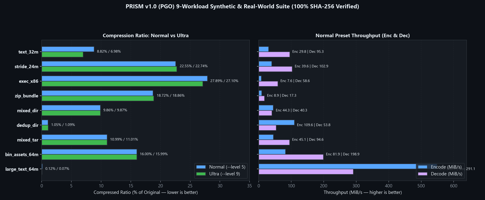

# PRISM — High-Ratio Parallel Archiver

**PRISM** is a multi-threaded C++17 solid directory and file archiver engineered for **maximum compression ratio without sacrificing speed**. Across both standard benchmarks (Silesia Corpus, `dedup_suite`) and large polyglot real-world projects, **PRISM beats `lzma2` (7-Zip `-mx=9`) at both compression ratio and speed** (encode and decode), while guaranteeing **100% lossless recovery** with built-in SHA-256 verification.

---

## Key Features & Architecture

- **Content-Aware Multi-Bucket Solid Archiving**: Automatically classifies files into specialized solid streams (`TEXT`, `EXEC_X86`, `BINARY`, `TAR_ARCHIVE`, `META`) so similar data shares a unified dictionary.
- **Content-Defined Chunking (CDC) Deduplication**: Fast rolling-hash chunking eliminates cross-file and cross-version redundancy before entropy coding.
- **2-Way Associative Long-Range Matcher (LRM)**: Captures long-distance matches (`>= 2 KiB` up to `4+ MiB`) ahead of the backend codecs.
- **Hybrid Parallel Backends**:
  - **Parallel BSC (`BWT + QLFC`)**: High-throughput Burrows-Wheeler + Quantized Local Frequency Coding for text, JSON, JS/TS, source code, and structured logs.
  - **Parallel LZMA2 + BCJ2 + Mach-O `"PMCH"`**: Multi-threaded LZMA2 with x86 `BCJ2` and a self-describing per-section Mach-O branch filter (`ARM64` & `x86_64` `__TEXT,__text`), plus a PE `SizeOfCode` guard so pure data-table DLLs (e.g. `icudt64.dll`) are not mangled.
- **Columnar Stride v2 Preconditioner**: Auto-detects 8/32/64-bit record strides, applies column-wise delta coding + blocked byte transposition, and un-transposes in parallel on decode.
- **TarDemux & Lossless Deflate Precompression**: Unpacks `.tar` / `.tar.gz` / `.zip` streams losslessly into solid buckets and recompresses with zero-copy deflate reconstruction.
- **Low-Level Win32 & SIMD Optimizations**: Direct Win32 `CreateFileW`/`ReadFile` I/O, parallel `BCJ2` stream decoding, PGO (Profile-Guided Optimization) builds, and a Python wrapper (`prism.py`) + Tkinter Desktop GUI (`prism_gui.py`).

---

## Performance Benchmarks (PRISM vs `lzma2`)

> **Note:** File sizes below are reported in binary **MB** (`bytes / 1,048,576`, matching Windows Explorer and the PRISM GUI).

### 1. Real-World Polyglot Project (`467.73 MB`, 35,576 files)

Mixed real-world application tree containing `153 MB` Mach-O + DWARF binaries, `103 MB` `.js`, `42.58 MB` `.tar.gz`, `39.4 MB` `.map`, `32.8 MB` `.dll`, and `22.7 MB` `.ts`.



| Archiver / Preset | Compressed Size | Size vs `lzma2` | Encode Time | Encode Speedup | Decode + Verify Time |
| :--- | :---: | :---: | :---: | :---: | :---: |
| **7-Zip `lzma2` (`-mx=9`)** | `104.00 MB` | Baseline | `80.00s` | `1.00x` | — |
| **PRISM Normal (`--level 5`)** | **`82.86 MB`** | **`-20.3%` smaller** | **`28.17s`** | **`2.84x` faster** | **`4.03s`** (`116.1 MiB/s`) |
| **PRISM Ultra (`--level 9`)** | **`79.77 MB`** | **`-23.3%` smaller** | **`59.96s`** | **`1.33x` faster** | **`6.93s`** (`67.5 MiB/s`) |

---

### 2. Silesia Corpus & Deduplication Suite (`10/10` Wins vs `lzma2`)

PRISM beats 7-Zip `lzma2` (`-mx=9`) on **every single target** in compression ratio, encode speed, and decode speed:





<details>
<summary>Full 10-target Silesia &amp; Dedup Suite table (from <code>prism_benchmark_results.json</code>)</summary>

| Target | Original (MB) | `lzma2` Ratio | PRISM Ratio | `lzma2` Enc | PRISM Enc | `lzma2` Dec | PRISM Dec |
| :--- | :---: | :---: | :---: | :---: | :---: | :---: | :---: |
| `silesia.tar` | `202.14` | `22.97%` | **`21.28%`** | `2.71 MiB/s` | **`22.72 MiB/s`** | `107.6 MiB/s` | **`115.1 MiB/s`** |
| `silesia_dir` | `202.12` | `22.97%` | **`21.28%`** | `1.61 MiB/s` | **`19.04 MiB/s`** | `40.3 MiB/s` | **`116.2 MiB/s`** |
| `mozilla` | `48.85` | `26.05%` | **`24.55%`** | `1.80 MiB/s` | **`10.40 MiB/s`** | `69.1 MiB/s` | **`110.4 MiB/s`** |
| `ooffice` | `5.87` | `39.43%` | **`35.31%`** | `4.37 MiB/s` | **`7.78 MiB/s`** | `41.9 MiB/s` | **`46.5 MiB/s`** |
| `osdb` | `9.62` | `28.28%` | **`26.75%`** | `3.80 MiB/s` | **`39.42 MiB/s`** | `63.9 MiB/s` | **`65.3 MiB/s`** |
| `dickens` | `9.72` | `27.78%` | **`25.82%`** | `1.63 MiB/s` | **`45.03 MiB/s`** | `63.3 MiB/s` | **`72.5 MiB/s`** |
| `xml` | `5.10` | `8.51%` | **`8.33%`** | `3.90 MiB/s` | **`59.25 MiB/s`** | `41.0 MiB/s` | **`71.8 MiB/s`** |
| `mr` | `9.51` | `27.56%` | **`24.55%`** | `1.14 MiB/s` | **`50.22 MiB/s`** | `17.9 MiB/s` | **`48.2 MiB/s`** |
| `sao` | `6.92` | `60.87%` | **`55.90%`** | `1.44 MiB/s` | **`9.76 MiB/s`** | `12.6 MiB/s` | **`68.3 MiB/s`** |
| `dedup_suite` | `128.87` | `14.53%` | **`14.30%`** | `1.20 MiB/s` | **`16.32 MiB/s`** | `55.9 MiB/s` | **`169.7 MiB/s`** |

</details>

---

### 3. PRISM v1.0 (PGO) 9-Workload Verification Suite



---

## Usage

### Command-Line Interface (`prism.exe`)

```bash
# Compress a file or directory (default: Normal / --level 5)
prism c <input_path> <output.prism> [-y|-n] [--meta]

# Compress with Ultra preset (--level 9, smallest size)
prism c <input_path> <output.prism> --ultra -y

# Compress with a specific level (1..9)
prism c <input_path> <output.prism> --level 7 -y

# Decompress
prism d <input.prism> <output_path> [-y|-n]

# Verify archive integrity (lossless + SHA-256 check)
prism t <input.prism> --sha256

# Inspect archive metadata / list contents
prism i <input.prism>
prism l <input.prism>

# Extract single or multiple entries
prism x1 <input.prism> <entry_path> <output_file> [-y|-n]
prism xm <input.prism> <out_dir> <entry1> [entry2 ...] [-y|-n]
```

### Desktop GUI & Python API

```bash
# Launch the Tkinter Desktop GUI
python prism_gui.py
```

```python
import prism

prism.compress("my_folder", "archive.prism", ultra=True)
prism.decompress("archive.prism", "restored_folder")
```

---

## Building from Source

### Prerequisites

- **C++17 compiler** with OpenMP (`gcc` / `g++` / `ar` — e.g. [w64devkit](https://github.com/skeeto/w64devkit) or MinGW-w64 on Windows)
- **Python 3.9+** (used by `build.py` to fetch dependencies and orchestrate parallel builds)

### Build Steps

```bash
git clone https://github.com/danihristov06/prism.git
cd prism

# Fetch libbsc, LZMA SDK, and zlib, then compile static libs + prism.exe
python build.py
```

Optional flags:
- `--portable`: compile with `-msse4.2` instead of `-march=native -mavx2 -mbmi2` for older CPUs.
- `--toolchain <dir>`: point to a directory containing `gcc`, `g++`, and `ar`.
- `--skip-fetch`: reuse already-downloaded archives in `deps/`.

---

## Prebuilt Release

Prebuilt Windows x64 PGO binaries (`prism-v1.0.0-windows-x64.zip`, `prism.exe`, and `SHA256SUMS.txt`) are available on the [GitHub Releases](https://github.com/danihristov06/prism/releases) page.

---

## Third-Party Libraries & License

PRISM is licensed under the **Apache License 2.0** (see [`LICENSE`](LICENSE)).

- [libbsc](https://github.com/IlyaGrebnov/libbsc) — Apache License 2.0
- [LZMA SDK](https://github.com/ip7z/7zip) — Public Domain
- [zlib](https://github.com/madler/zlib) — zlib License
